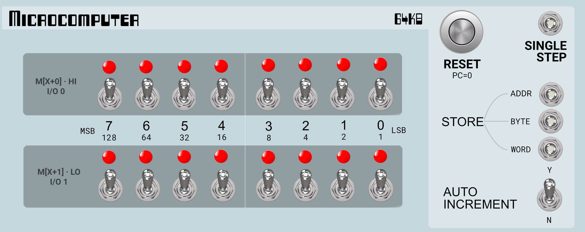
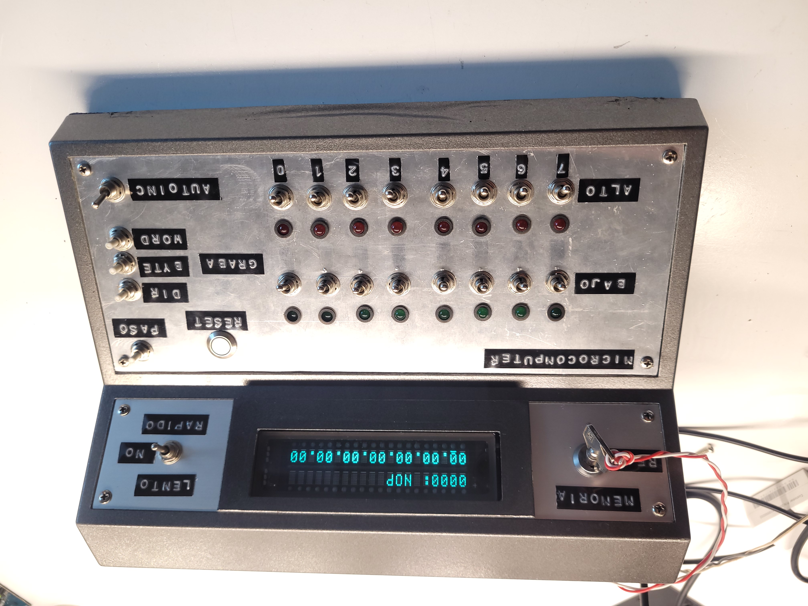
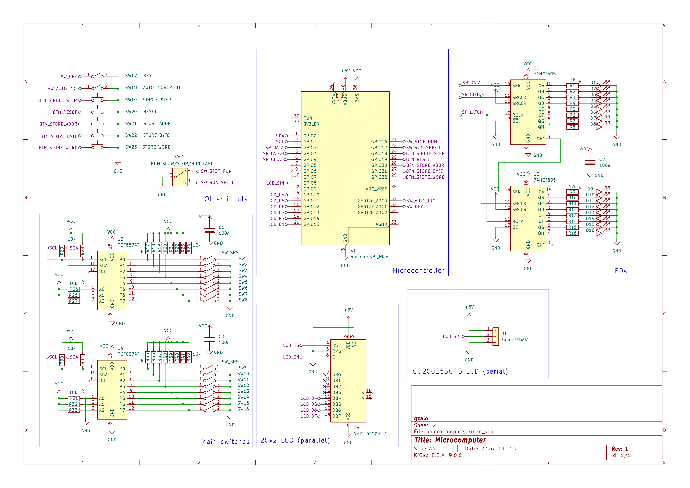

# Microcomputer project

An Altair/Imsai style microcomputer project based on a Raspberry Pi Pico (RP2040). Instruction set is 8080, but in the future it may be switchable between 8080, 6502, Z80, RISC-V, ARM, etc. 

Address space will be 16 bit so maximum RAM/ROM is 64 KiB. 

Extra I/O devices like keyboard and console may be added later.

[Try the web version here!](https://gzalo.github.io/microcomputer/)

For a hacker-party field guide in Spanish, including the built-in CTF challenges, see [Expediente 8080](docs/guia-fiesta-hacker.md).

## Hardware

- Inputs: 
  - 16 addr/data switches (read using two pcf8574 with pullups) 
  - 8 extra buttons/switches that are read directly:
    - 2 inputs connected to 3 position switches: stop/run slow/run fast
    - 1 input connected to a momentary push button: single step
    - 1 input connected to a momentary push button: reset (PC=0)
    - 1 input connected to a momentary push button: store to address latch
    - 1 input connected to a momentary push button: store byte
    - 1 input connected to a momentary push button: store word
    - 1 input connected to a switch: auto increment Y/N
- Outputs:
  - 16 LEDs for low and high parts (driven by 2 cascaded 74hc595) 
  - 20x2 Noritake CU20025SCPB-T series VFD over serial (default firmware build)
  - Optional HD44780-compatible parallel LCD on GPIO 10–15

### Serial VFD

The firmware uses the CU20025SCPB-T20A command set. Connect Pico **GP8 (UART1 TX)** to the VFD **SIN/TEST** input, and connect the grounds. The VFD's 3-pin power connector is pin 1 = **5 V**, pin 2 = **SIN/TEST**, pin 3 = **GND**. Supply the VFD from a regulated 5 V source capable of its roughly 320 mA typical draw; the Pico's 3.3 V TX level meets the T20A's 2.0 V minimum logic-high input. Do not connect a 5 V VFD output directly to a Pico GPIO. The existing PCB/schematic still shows the parallel LCD; the serial VFD requires separate wiring.

The default serial setting is **19200 baud, 8 data bits, even parity, 1 stop bit**. This matches the T20A's open J2/J1/J0 baud jumpers and open J4/J3 parity jumpers. If your module has different jumper settings, adjust the baud rate and parity in `firmware/pins.h` and `firmware/vfd_serial.c` to match. The module's serial input is logic-level, not RS-232 voltage level.

Build the default VFD firmware from `firmware` with `cmake -S . -B build/vfd -DDISPLAY_BACKEND=VFD` and `cmake --build build/vfd`. The UF2 will be at `build/vfd/microcomputer.uf2`. To build for the original parallel LCD, use a separate build directory and `-DDISPLAY_BACKEND=HD44780`. The web emulator continues to show the same 20x2 text layout.

## AI

The firmware for this project was created with LLMs (Claude Opus 4.5, GPT-5 and onwards). [I've recorded most of the prompts in here](ai_prompts.md).
